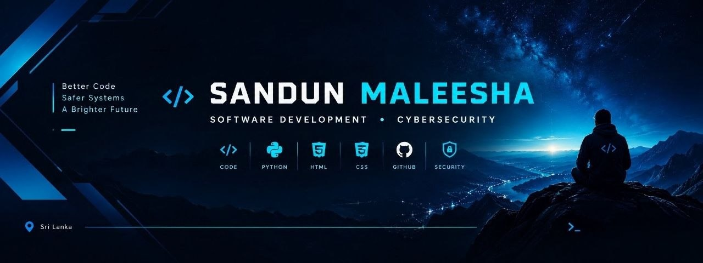

  

<h1 align="center">Hey, I'm Sandun 👋</h1>
<h3 align="center">Aspiring Software Developer | Cybersecurity Enthusiast</h3>

  Building my foundations in software development and exploring cybersecurity.

---

### 👨‍💻 About Me

- 🎓 Learning computer science through CS50x
- 💻 Exploring programming and web development
- 🔐 Interested in cybersecurity and secure software
- 🚀 Focused on learning, problem-solving, and continuous improvement

### 🛠️ Technologies I'm Learning

  
  
  
  
  

### 🎯 Current Goals

- Strengthen my computer science fundamentals
- Improve my programming and debugging skills
- Learn to build secure and useful software
- Explore the connection between software development and cybersecurity

---

  <i>Learning consistently. Improving every day.</i>

